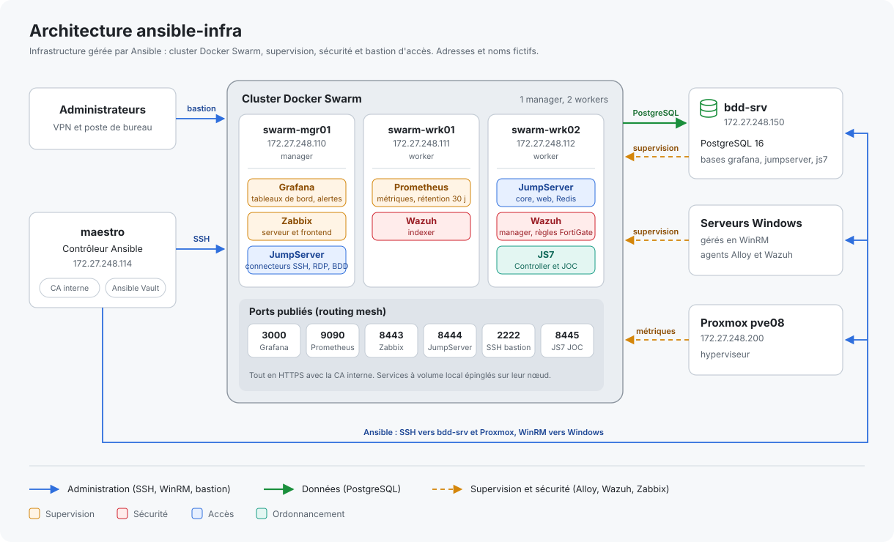

# ansible-infra

[](https://github.com/salaheddinsem-prog/ansible-infra/actions/workflows/lint.yml)

Automatisation Ansible d'une infrastructure on-premise : cluster Docker Swarm, supervision (Prometheus, Grafana, Zabbix, Wazuh), bastion d'accès JumpServer, ordonnanceur JS7 et bases PostgreSQL, sur des hôtes Linux et Windows.

> Les adresses IP, domaines et noms présents dans ce dépôt sont fictifs. Les secrets sont gérés avec Ansible Vault et ne sont pas versionnés.

## Architecture



| Hôte | Adresse | Rôle |
|---|---|---|
| maestro | 172.27.248.114 | Contrôleur Ansible, CA interne |
| swarm-mgr01 | 172.27.248.110 | Manager Swarm : Grafana, Zabbix, connecteurs JumpServer |
| swarm-wrk01 | 172.27.248.111 | Worker Swarm : Prometheus, indexer Wazuh |
| swarm-wrk02 | 172.27.248.112 | Worker Swarm : JumpServer core, Wazuh manager, JS7 |
| bdd-srv | 172.27.248.150 | PostgreSQL 16 (bases applicatives) |
| pve08 | 172.27.248.200 | Hyperviseur Proxmox |

## Services

| Service | Rôle / stack | Nœud | Port |
|---|---|---|---|
| Grafana | `grafana_stack` | swarm-mgr01 | 3000 (HTTPS) |
| Prometheus | `prometheus_stack` | swarm-wrk01 | 9090 (HTTPS) |
| JumpServer | `jumpserver_stack` | swarm-wrk02 / swarm-mgr01 | 8082, 8444 (HTTPS), 2222 (SSH) |
| Wazuh manager | `wazuh_manager` | swarm-wrk02 | — |
| JS7 JOC | `stacks/js7` | swarm-wrk02 | 8445 (HTTPS) |
| Zabbix (frontend / API) | — | swarm-mgr01 | 8443 (HTTPS) |
| PostgreSQL | `postgresql_app_db` | bdd-srv | 5432 |

## Structure du dépôt

```
ansible-infra/
├── ansible.cfg
├── requirements.yml              # collections Ansible
├── requirements-controller.txt   # dépendances Python du contrôleur
├── inventory/
│   ├── group_vars/               # variables par groupe (vault.yml non versionnés)
│   └── host_vars/
├── roles/                        # un README par rôle
├── stacks/
│   └── js7/                      # déploiement JS7 (procédure documentée)
└── *.yml                         # playbooks
```

## Prérequis

Sur le contrôleur :

```bash
python3 -m venv /opt/ansible
source /opt/ansible/bin/activate
pip install -r requirements-controller.txt     # ansible-core, pywinrm
ansible-galaxy collection install -r requirements.yml
```

Les hôtes Windows sont gérés via WinRM (compte de service du domaine).

## Gestion des secrets

Les secrets sont stockés dans des fichiers Ansible Vault exclus du dépôt (`**/vault.yml` dans `.gitignore`) :

```
inventory/group_vars/all/vault.yml
inventory/group_vars/swarm/vault.yml
inventory/group_vars/windows/vault.yml
inventory/host_vars/bdd-srv/vault.yml
```

Les variables chiffrées sont préfixées par `vault_` et référencées depuis les variables des rôles, par exemple :

```yaml
grafana_api_token: "{{ vault_grafana_sa_token }}"
```

Pour créer un fichier Vault :

```bash
ansible-vault create inventory/group_vars/all/vault.yml
```

## Playbooks

| Playbook | Description |
|---|---|
| `ca-trust.yml` | Déploie la racine de la CA interne (Linux et Windows) |
| `admin_users.yml` | Comptes administrateurs nominatifs |
| `ansible_account.yml` | Compte d'automatisation sur bdd-srv, clé limitée à l'IP du contrôleur |
| `cloud_init_disable.yml` | Désactive cloud-init sur les hôtes |
| `nftables.yml` | Pare-feu nftables |
| `postgresql-app-db.yml` | Bases et accès PostgreSQL applicatifs |
| `prometheus-stack.yml` | Stack Prometheus sur Swarm |
| `grafana-stack.yml` | Stack Grafana sur Swarm |
| `grafana-datasource.yml` | Datasource Prometheus dans Grafana |
| `grafana-zabbix-datasource.yml` | Plugin et datasource Zabbix dans Grafana |
| `grafana-dashboards.yml` | Import des dashboards |
| `grafana-alerting.yml` | Point de contact, politique de notification et règles d'alerte |
| `alloy.yml` | Agent Grafana Alloy (métriques Linux et Windows) |
| `zabbix-agent2.yml` | Agent Zabbix 2 |
| `wazuh-agent.yml` | Agent Wazuh (Linux et Windows) |
| `jumpserver-stack.yml` | Bastion JumpServer sur Swarm |
| `monitoring.yml` | Enchaînement des playbooks de supervision |

## Ordre de déploiement suggéré

```bash
ansible-playbook ca-trust.yml
ansible-playbook admin_users.yml ansible_account.yml
ansible-playbook nftables.yml
ansible-playbook postgresql-app-db.yml
ansible-playbook prometheus-stack.yml grafana-stack.yml
ansible-playbook grafana-datasource.yml grafana-zabbix-datasource.yml
ansible-playbook grafana-dashboards.yml grafana-alerting.yml
ansible-playbook alloy.yml zabbix-agent2.yml wazuh-agent.yml
ansible-playbook jumpserver-stack.yml
```

Ajouter `--ask-vault-pass` (ou `--vault-password-file`) selon votre configuration.

## Conventions

- **Versions épinglées** pour chaque image et paquet, mises à jour volontairement.
- **Secrets et configs Docker immuables** : chaque stack possède une variable `*_secrets_version` à incrémenter pour publier un nouveau contenu.
- **Placement épinglé** des services qui utilisent un volume local (Grafana, Prometheus, JumpServer core).
- **TLS partout** avec la CA interne ; les certificats sont des secrets Swarm créés hors Ansible.
- **Idempotence** : les rôles qui pilotent une API (Grafana) ne réécrivent rien sans changement, sauf si la variable `*_force` est passée à `true`.

## Sécurité

- Pare-feu nftables par hôte, avec des ensembles d'adresses autorisées (administration, contrôleur, nœuds Swarm).
- Clé SSH du compte Ansible limitée à l'adresse du contrôleur (`from=`), fichier `authorized_keys` exclusif.
- Comptes administrateurs nominatifs, UID/GID harmonisés.
- Supervision de sécurité par Wazuh sur l'ensemble du parc.
